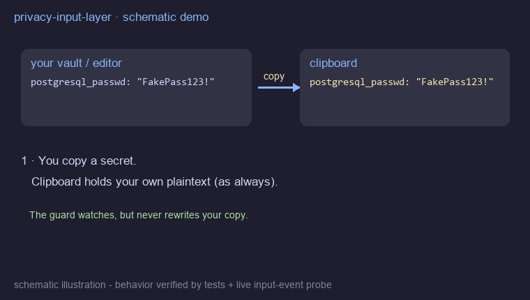

# privacy-input-layer

[](https://github.com/FanKang2021/privacy-input-layer/actions/workflows/ci.yml)
[](LICENSE)
[](pyproject.toml)

**The privacy input layer for AI.** Mask sensitive text, images and files *before* they enter any AI client — platform-native models, web apps, desktop apps, installed page-as-app windows alike. Interception happens at the OS input boundary (clipboard / paste / file upload), not at the network layer, so it works everywhere regardless of protocol.

100% local: regex rules + local OCR + local sqlite mapping. Your originals never leave your machine.



[中文文档](README.zh.md) · [Launch kit](docs/launch.md) · [Security policy](SECURITY.md) · [Changelog](CHANGELOG.md)

## Why

Proxy-style masking (a reverse proxy behind a custom baseUrl) only covers BYOK endpoints — platform-native models speak private protocols with no hookable entry point. But every client obtains data through the same OS-level doors: **clipboard paste, screenshot paste, file upload**. Guard those doors and you guard every platform.

## Coverage

| Scenario | Behavior | User effort |
|---|---|---|
| Copy text → paste into any AI client | Auto-replaced with placeholders (CN phone / ID card / bank card / email / PEM private keys / IPv4 / API tokens / assignment-style passwords & secrets / internal URLs / custom keywords) | none |
| Copy AI reply containing placeholders | Auto-restored to real values | none |
| Screenshot / copy image → paste | OCR locates sensitive text lines, pixels masked (irreversible) | none |
| Copy file → paste to upload | Clipboard file paths swapped to masked copies | none |
| Right-click file → Send to → Masked copy | Generates `.masked` copy for upload | one step |
| Restore AI-produced files | `restore-file` swaps placeholders back | one command |

File formats: `txt / md / csv / json / log / docx / xlsx`.

## Quick start

```bash
python -m venv .venv
.venv\Scripts\activate        # PowerShell: .venv\Scripts\Activate.ps1
pip install -e .              # text + file masking
pip install -e .[image]       # add image OCR masking
pilayer run                   # tray app, guarding starts
pilayer install-sendto        # optional: right-click "Send to -> Masked copy"
```

No terminal needed: double-click `start-guard.bat` in the project root (no console window).

Tray icon: blue = guarding, gray = paused. Tray menu: guard on/paused, **notifications on/off (silent mode)**, **language English/中文**, **mode focus/always**, **Start with Windows**, **Recent masks** (audit, no secrets), **Restore clipboard now**, open config, open data dir, quit.

Prebuilt binaries: see [Releases](https://github.com/FanKang2021/privacy-input-layer/releases) (Windows / macOS-arm64 / Linux-x86_64).

## Platform support

| Platform | Clipboard guard | Focus-aware | Paste injection | Image OCR | Tray |
|---|---|---|---|---|---|
| Windows | yes | yes (UIA signatures) | yes | yes | yes |
| macOS | yes | yes (bundle ID + AX scan) | yes (needs Accessibility permission) | roadmap | yes |
| Linux X11 | yes | yes (WM_CLASS / title) | yes (xdotool) | roadmap | yes (system tray required) |
| Linux Wayland | degraded | always-on only | no (security model) | no | yes |
| Web (extension) | DOM paste masking | all sites by default (popup toggle) | n/a | n/a | popup |

Linux clipboard I/O delegates to `xclip`/`xsel` and injection to `xdotool`
(install via your package manager); without them the guard degrades gracefully.

Release binaries: `pilayer-guard.exe` (Windows), `pilayer-guard-macos-arm64`,
`pilayer-guard-linux-x86_64`. Intel macOS has no prebuilt (Intel CI runners
retired; PyInstaller cannot cross-compile) — use `pip install -e .[image]`.
macOS binaries are unsigned: right-click → Open once (or
`xattr -d com.apple.quarantine <file>`); Linux: `chmod +x` first.

macOS/Linux backends share the same engine (rules, DPAPI-equivalent local mapping,
i18n) as the Windows reference implementation; CI verifies them on
macos-latest and ubuntu-latest (Xvfb). Wayland's security model forbids global
input injection and foreground queries, so the guard honestly degrades to
clipboard-only always-on there.

### Browser extension (MV3)

Load `extension/` unpacked (chrome://extensions → Developer mode → Load unpacked;
reload after updates). It masks secrets at paste time inside web chat inputs on
**all sites by default** (toggle in popup), complementing the OS layer for
widgets without accessibility signatures (contenteditable sidebars,
internal-scheme new-tab pages). Mappings stay in `chrome.storage.local`; the OS
guard restores placeholders when you copy replies outside AI.

## Supported clients

Three detection layers: **curated list** (known desktop shells) + **zero-config UIA signatures** (unknown apps/sites) + **self-learning** (copying ≥2 placeholders from an unclassified app learns its process; remove entries under `ai_targets.learned_processes` to unlearn).

| International | China |
|---|---|
| Qoder / Qoder CN | WorkBuddy |
| Cursor / Windsurf / Trae | Comate / Lingma |
| Claude / ChatGPT / Copilot / Gemini | Doubao / Kimi / Tongyi |
| CodeBuddy | DeepSeek / Yuanbao / ChatGLM / MiniMax |
| LM Studio / Jan / Cherry Studio / Chatbox / AnythingLLM / Msty | |

Web clients (ChatGPT/Claude/Gemini/DeepSeek/Kimi/… sites), embedded AI widgets (inkeep/Telly-style) and browser new-tab chats are covered by signatures/URL/title rules without any list. Missing a client? See [CONTRIBUTING.md](CONTRIBUTING.md).

### CLI

```bash
pilayer mask-text "John's phone 13800138000"   # -> John's phone [PHONE_1]
pilayer restore-text "phone [PHONE_1]"         # -> phone 13800138000
pilayer mask-file report.docx                  # -> report.masked.docx
pilayer restore-file ai-output.docx            # -> ai-output.restored.docx
pilayer stats                                  # local mapping statistics
```

Placeholder↔original mappings live in `%APPDATA%/pilayer/mappings.db` (local sqlite). The same original reuses the same placeholder across turns, keeping AI context consistent.

## Focus-aware mode (default)

With `guard.mode: focus` the clipboard is masked only while an AI conversation client is in the foreground, and restored when you switch away. Normal copy/paste is never disturbed.

**Zero-config auto-detection (`auto_detect: true`)**: a UIA scan of the foreground window classifies any app/site as an AI conversation when it hits a generic signature — no lists required:

1. **Model picker controls** (spark-x2.6 / Qwen3.8-Max / gpt-4o / claude-…): matched only on picker-type controls *inside page document subtrees* (including iframes), so browser chrome AI buttons and article prose never trigger it
2. **AI disclaimer short labels** (≤60 chars: "AI helper", "Powered by inkeep", "内容由 AI 生成"…)
3. **Chat input signatures** on Edit/Custom/Pane controls across Name/Value/HelpText ("Ask … a question", "prompt", "尽情提问", "想聊点"…), plus short chat headings

**Fallback / override lists** (`ai_targets`, optional): process whitelist, browser URL domains, page-title patterns, and `newtab_chat_browsers` for browsers whose new-tab page is a built-in AI chat (e.g. Tabbit). Useful for Electron clients with sparse accessibility trees, or to force/exclude targets.

**Race closure & clipboard hygiene**: foreground changes re-evaluate immediately; a 300 ms poll catches in-browser tab switches and title changes. A low-level keyboard hook intercepts Ctrl+V / Shift+Insert (swallowing the orphan keyup and re-sending adaptively so host modifier latches never break):
- **Mask direction** (into AI): masked text goes to the clipboard and the real paste is re-sent, **chunked** (`paste_chunk_size`, default 400 chars / `paste_chunk_delay_ms` 40 ms) to amortize host rendering of huge inputs; clipboard holds only masked text.
- **Restore direction** (outside AI): plaintext is injected via SendInput after physical modifiers release, so it never touches the clipboard / Win+V history / cloud sync (`paste_injection: true`; `false` = one-shot clipboard path with that trade-off).
Signature scans are cached 5 s to bound overhead.

`guard.mode: always` switches back to global always-on masking.

## Configuration

`%APPDATA%/pilayer/config.yaml` (auto-created; template in [config.example.yaml](config.example.yaml)):

- `guard.*`: mode, text/image/hdrop switches, auto_restore, notify, auto_detect, paste_hook, paste_injection, paste_chunk_size, paste_chunk_delay_ms, lazy_restore
- `rules.*`: per-rule switches + `custom_keywords` (names, project codenames, …)
- `ai_targets.*`: fallback identification lists
- `image.min_score` / `image.fill`: OCR threshold and mask color
- `store.ttl_days`: mapping expiry
- `ui.language`: `en` / `zh` for tray menu and notifications

## How it works

1. **Event-driven clipboard listener** (`AddClipboardFormatListener`), fires on copy, no polling.
2. **Rule engine**: CN phone / ID card (checksum) / bank card (Luhn) / email / PEM key blocks / IPv4 / token prefixes / assignment-style secrets (`*passwd/pwd/password/secret/token/api_key/access_key*` values, keys preserved, Jinja `{{ }}` refs skipped) / internal URLs (private-IP or templated hosts, plus `rules.internal_domains`) + custom keywords; millisecond-scale, ahead of the paste.
3. **Self-write suppression**: clipboard sequence numbers skip events caused by our own writes (no mask↔restore loops).
4. **Images**: clipboard DIB → RapidOCR text lines → rule hit → pixel fill of the whole line.
5. **Files**: masked copies generated on paste-swap; docx handled per paragraph (PII can span runs), xlsx string cells only (formulas preserved).
6. **Paste hook**: WH_KEYBOARD_LL intercepts Ctrl+V / Shift+Insert, swallows the orphan keyup and re-sends adaptively (physical modifier held → main key only). Mask direction pastes masked clipboard text in chunks; restore direction injects plaintext via SendInput after modifiers release (clipboard-write fallback on injection failure).

## Security design

Reviewed against gitleaks/detect-secrets baselines, OWASP ASVS V8 & Logging Cheat Sheet, PCI DSS 3.3/3.4, GB/T 35273/PIPL and GDPR art 5/32:

- **Encrypted at rest**: mapping originals are stored DPAPI-encrypted (current-user key) in sqlite — PCI DSS 3.4 / ASVS V8. Legacy plaintext rows are migrated automatically on first start. Dedup uses a sha256 column, never decrypting the table.
- **Storage limitation**: mappings auto-purge after `store.ttl_days` (default 30); manual `pilayer purge` (GDPR art 5(1)(e)).
- **Lazy restore + injection**: leaving an AI client does NOT write plaintext back to the shared clipboard (clipboard history / RDP / malware can read it). Restoration happens on demand via paste-time injection, or copying placeholder text outside AI when `paste_injection: false`. Trade-off: menu/right-click paste outside AI yields placeholders; set `lazy_restore: false` for the old proactive behavior.
- **Log redaction**: `pilayer.log` records only process names and signature kinds — never window titles, URLs or control text (OWASP Logging Cheat Sheet).
- **Rule baseline**: checksum/Luhn validation, URI userinfo passwords, PGP/PEM blocks, vendor token families, assignment-style secrets (whole-line bare values, no truncation residue), internal URLs; optional high-entropy rule (`rules.entropy`, off by default). Over-masking is the safe direction.
- **Placeholder linkage**: the same original reuses the same placeholder across sessions, so an AI could correlate conversations. Accepted trade-off for context consistency; purge resets it.
- **No keylogging**: the keyboard hook inspects only Ctrl+V / Shift+Insert combinations, never records keystrokes.

## Known limitations

- **Platform caveats**: Linux Wayland degrades to clipboard-only always-on (compositor forbids global injection/foreground queries); Intel macOS has no prebuilt (use pip); macOS binaries unsigned (Gatekeeper note above).
- Large one-shot pastes can stutter in some hosts (their rendering cost); chunked paste amortizes it — tune `paste_chunk_size` if needed.
- Image masking granularity is the OCR text line (over-masks neighboring non-sensitive text on the same line — safer direction).
- Rewriting the clipboard strips rich-text formats (HTML/RTF) to prevent clients reading originals from alternate clipboard formats.
- Image OCR on window-switch takes hundreds of ms; an extremely fast image paste inside that window can slip through (text is covered by the paste hook).
- Files read from disk after upload cannot be intercepted transparently in user mode — hence the masked-copy step. PDF not supported yet.
- docx masking rewrites paragraphs as a whole (PII can span runs), so per-run formatting inside masked paragraphs is lost; xlsx formulas and non-string cells are preserved.
- Auto-detection depends on clients exposing accessibility trees; a few Electron shells expose sparse trees and need one whitelist line (or launch with `--force-renderer-accessibility`). Rare false positives possible (e.g. a human chat app with model-named controls); disable with `auto_detect: false`.
- Names/addresses without regex signatures rely on `custom_keywords` for now; local NER on the roadmap.
- Image masking is irreversible by design: masked pixels contain no originals.

## Roadmap

- [ ] Local NER for names / addresses / organizations
- [ ] PDF masked copies
- [ ] Code signing (SmartScreen / corporate EDR allowlisting)
- [ ] Opt-in local LLM pre-send review (semantic secrets)
- [ ] Extension store publishing; Intel macOS prebuilt
- [x] macOS / Linux backends, MV3 extension, mapping expiry (shipped v0.4.x)

## Privacy

No network requests at all. OCR runs locally; mappings stay in local sqlite. Delete `%APPDATA%/pilayer` to erase everything. Logs (no secrets, only detection metadata) at `%APPDATA%/pilayer/pilayer.log`.

## License

MIT