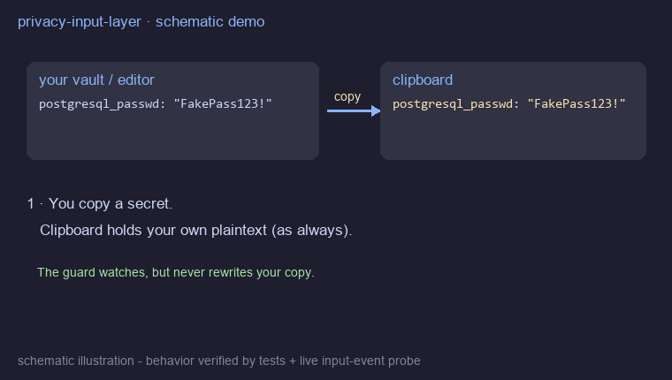

# privacy-input-layer

[](https://github.com/FanKang2021/privacy-input-layer/actions/workflows/ci.yml)
[](LICENSE)
[](pyproject.toml)

**AI 隐私输入层**：在内容进入任何 AI 客户端之前完成脱敏。不挑平台、不挑模型——平台自带模型、网页版、桌面端、"网页安装到桌面"的 app 窗口全部通用，因为拦截发生在数据进入客户端**之前**的 OS 输入边界（剪贴板/粘贴/文件上传），而不是网络出站时。

全部本地运行：规则引擎 + 本地 OCR + 本地 sqlite 映射，原文永远不离开你的机器。



[English](README.md) · [发布工具包](docs/launch.md) · [安全政策](SECURITY.md) · [更新日志](CHANGELOG.md)

## 为什么需要它

代理式脱敏（改 baseUrl 的反向代理）只能覆盖自定义端点，对平台自带模型无效——私有协议没有可改的入口。但任何客户端拿数据都绕不开几个 OS 级入口：**剪贴板粘贴、截图粘贴、文件上传**。守住这些入口，就守住了所有平台。

## 覆盖能力

| 场景 | 效果 | 用户操作 |
|---|---|---|
| 复制文本 → 粘贴进任意 AI 客户端 | 自动替换为占位符（手机号/身份证/银行卡/邮箱/PEM 私钥/IPv4/API 令牌/赋值型密码密钥/内网 URL/自定义词） | 零 |
| 复制 AI 回复（含占位符） | 自动还原为真实值 | 零 |
| 截图 / 复制图片 → 粘贴 | OCR 定位敏感文字区域，像素打码（不可逆） | 零 |
| 复制文件 → 粘贴上传 | 剪贴板中的文件路径自动替换为脱敏副本 | 零 |
| 右键文件 → 发送到 → Masked copy | 生成 `.masked` 副本供上传 | 一步 |
| AI 产出的文件回填 | `restore-file` 将占位符换回真实值 | 一条命令 |

支持文件：`txt / md / csv / json / log / docx / xlsx / pptx / odt / ods / odp / png / jpg / jpeg / bmp / webp / pdf`。
图片与 PDF 经本地 OCR 像素打码（不可逆）；PDF 输出为图像型（文本层丢失）。legacy 二进制 `.doc / .xls / .ppt` 不支持——先另存为现代格式。

## 快速开始

```bash
python -m venv .venv
.venv\Scripts\activate        # PowerShell: .venv\Scripts\Activate.ps1
pip install -e .              # 文本 + 文件脱敏
pip install -e .[image]       # 加上图片 OCR 打码
pilayer run                   # 托盘常驻，开始守卫
pilayer install-sendto        # 可选：右键「发送到 -> Masked copy」
```

不想开终端：双击项目根目录的 `start-guard.bat`（无控制台窗口）。

托盘图标：蓝色 = 守卫开启，灰色 = 暂停。托盘菜单：守卫开关、**通知开/关（静默模式）**、**语言 English/中文**、**模式 focus/always**、**开机自启**、**立即还原剪贴板**、**安装右键发送到入口**、**脱敏浮窗开/关**、**检查更新**（手动；`update_check` 可 opt-in 自动）、打开配置、打开数据目录、退出。浮窗仅当拖拽光标离开源窗口移到另一顶层窗口时对 Explorer 文件拖拽自动弹出（桌面/任务栏图标 rearrange 不弹；文件夹选中项经 Shell COM 按支持格式过滤、不支持 drop 时拒绝）、松手后延时隐藏（`guard.drop_zone_auto`）；点 X 仅隐藏可再开。

预构建产物见 [Releases](https://github.com/FanKang2021/privacy-input-layer/releases)（Windows / macOS-arm64 / Linux-x86_64）。

## 平台支持

| 平台 | 剪贴板守卫 | 焦点感知 | 粘贴注入 | 图片 OCR | 托盘 |
|---|---|---|---|---|---|
| Windows | ✓ | ✓（UIA 签名） | ✓ | ✓ | ✓ |
| macOS | ✓ | ✓（bundle ID + AX 扫描） | ✓（需辅助功能权限） | 路线图 | ✓ |
| Linux X11 | ✓ | ✓（WM_CLASS/标题） | ✓（xdotool） | 路线图 | ✓（需系统托盘） |
| Linux Wayland | 降级 | 仅常开 | ✗（安全模型禁止） | ✗ | ✓ |
| Web（扩展） | DOM 粘贴掩码 | 默认全站（popup 可关） | n/a | n/a | popup |

Linux 剪贴板读写委托 `xclip`/`xsel`、注入委托 `xdotool`（包管理器安装）；
缺失时守卫优雅降级。

发布产物：`pilayer-guard.exe`（Windows）、`pilayer-guard-macos-arm64`、
`pilayer-guard-linux-x86_64`。Intel Mac 无预构建（Intel CI runner 已退役、
PyInstaller 不能跨编译）——用 `pip install -e .[image]`。macOS 产物未签名：
首次右键→打开（或 `xattr -d com.apple.quarantine <文件>`）；Linux 先 `chmod +x`。

macOS/Linux 后端与 Windows 参考实现共享同一引擎（规则/本地映射/i18n）；CI 在
macos-latest 与 ubuntu-latest（Xvfb）验证。Wayland 安全模型禁止全局输入注入与
前台查询，守卫如实降级为仅剪贴板常开模式。

### 浏览器扩展（MV3）

chrome://extensions → 开发者模式 → 加载已解压的扩展程序 → 选 `extension/`（更新后需点重新加载）。
**默认全站**在网页聊天输入框粘贴时即时掩码（popup 可关），补 OS 层对无无障碍特征
widget（contenteditable sidebar、内部 scheme 新标签页）的盲区。映射存
`chrome.storage.local`；在 AI 外复制回复时由 OS 守卫还原占位符。

## 支持的客户端

三层检测：**精选名单**（已知桌面壳）+ **零配置 UIA 签名**（未知应用/网站）+ **自学习**（从未分类应用复制 ≥2 个占位符即学习其进程；在 `ai_targets.learned_processes` 删除条目可撤销）。

| 国际 | 国内 |
|---|---|
| Qoder / Qoder CN | WorkBuddy |
| Cursor / Windsurf / Trae | Comate / Lingma |
| Claude / ChatGPT / Copilot / Gemini | 豆包 / Kimi / 通义 |
| CodeBuddy | DeepSeek / 元宝 / ChatGLM / MiniMax |
| LM Studio / Jan / Cherry Studio / Chatbox / AnythingLLM / Msty | |

网页端（ChatGPT/Claude/Gemini/DeepSeek/Kimi… 站点）、内嵌 AI widget（inkeep/Telly 类）、浏览器新标签页 chat 由签名/URL/标题规则覆盖，无需名单。缺客户端？见 [CONTRIBUTING.md](CONTRIBUTING.md)。

### CLI

```bash
pilayer mask-text "张三的手机 13800138000"     # -> 张三的手机 [PHONE_1]
pilayer restore-text "手机 [PHONE_1]"          # -> 手机 13800138000
pilayer mask-file report.docx                  # -> report.masked.docx
pilayer restore-file ai-output.docx            # -> ai-output.restored.docx
pilayer stats                                  # 本地映射统计
```

占位符与原文的映射保存在 `%APPDATA%/pilayer/mappings.db`（sqlite，仅本机）。同一原文在多轮对话中复用同一占位符，保证 AI 上下文一致。

## 焦点感知模式（默认）

`guard.mode: focus` 时，守卫只在 **AI 对话客户端处于前台**时脱敏剪贴板；切回普通应用自动还原。复制粘贴在普通场景完全不受干扰。

**零配置自动检测（`auto_detect: true`，默认）**：UIA 扫描前台窗口，命中任一通用签名即判定 AI 对话，新客户端/新网站开箱即识别：

1. **模型选择器控件**（spark-x2.6 / Qwen3.8-Max / gpt-4o / claude-…）：只匹配 picker 类控件且位于页面 document 子树内（含 iframe），浏览器外壳 AI 按钮与网页正文不会误触发
2. **AI 声明短文本**（≤60 字："AI helper"、"Powered by inkeep"、"内容由 AI 生成"…）
3. **聊天输入框特征**：Edit/Custom/Pane 控件的 Name/Value/HelpText 命中"Ask … a question / prompt / 尽情提问 / 想聊点…"，以及短聊天标题

**配置名单兜底**（`ai_targets`，可选）：进程白名单、浏览器 URL 域名、页面标题模式、新标签页内置 chat 浏览器（`newtab_chat_browsers`，如 Tabbit）。用于无障碍树暴露不全的 Electron 客户端，或强制指定/排除。

**竞态关闭与剪贴板卫生**：前台切换立即重新评估；300ms 轮询捕捉浏览器内换 tab 与标题变化。低级键盘钩子拦截 Ctrl+V / Shift+Insert（吞掉孤儿 keyup、自适应补发，宿主修饰键 latch 不紊乱）：
- **掩码方向**（进 AI）：掩码文本上剪贴板并补发真实粘贴，**分块**（`paste_chunk_size` 默认 400 字 / `paste_chunk_delay_ms` 40ms）摊销宿主大输入渲染成本；剪贴板只持有掩码态。
- **还原方向**（出 AI）：默认剪贴板一次性写入 + 真实粘贴（即时、原格式；明文短暂在剪贴板）。隐私模式 `paste_injection: true` 在物理修饰键释放后 SendInput 注入，明文不进剪贴板 / Win+V / 云同步（较慢、逐字渲染）。
签名扫描缓存 5s 控制开销。

`guard.mode: always` 可切回全局常开模式。

## 配置

`%APPDATA%/pilayer/config.yaml`（首次运行自动生成，模板见 [config.example.yaml](config.example.yaml)）：

- `guard.*`：mode、文本/图片/文件开关、auto_restore、notify、auto_detect、paste_hook、paste_injection、paste_chunk_size、paste_chunk_delay_ms、lazy_restore、update_check
- `rules.*`：各规则开关 + `custom_keywords`（人名、项目代号等）
- `ai_targets.*`：兜底识别名单
- `image.min_score` / `image.fill`：OCR 置信度阈值与打码颜色
- `store.ttl_days`：映射过期
- `ui.language`：托盘菜单与通知语言 `en` / `zh`

## 工作原理

1. **事件监听**：`AddClipboardFormatListener` 消息窗口，复制瞬间触发，非轮询。
2. **规则引擎**：手机号 / 身份证（校验位）/ 银行卡（Luhn）/ 邮箱 / PEM 私钥块 / IPv4 / 令牌前缀 / 赋值型密钥（`*passwd/pwd/password/secret/token/api_key/access_key*` 的值，保留键名，Jinja `{{ }}` 引用跳过）/ 内网 URL（私网 IP 或模板化主机，另可配 `rules.internal_domains`）+ 自定义词，毫秒级，挡在粘贴之前。
3. **防自触发**：写入剪贴板后记录序列号，跳过自己引发的事件，避免脱敏↔还原死循环。
4. **图片**：剪贴板 DIB → RapidOCR 定位文字行 → 命中规则则整行像素填充。
5. **文件**：粘贴替换时生成脱敏副本；docx 段落级处理（PII 可能跨 run 拆分），xlsx 仅处理字符串单元格、保留公式。
6. **粘贴钩子**：WH_KEYBOARD_LL 拦截 Ctrl+V / Shift+Insert，吞孤儿 keyup、自适应补发（物理修饰键仍按住时只补发主键）。掩码方向分块粘贴掩码态剪贴板文本；还原方向在修饰键释放后 SendInput 注入明文（注入失败回退剪贴板写入）。

## 安全设计

对照 gitleaks/detect-secrets 基线、OWASP ASVS V8 与日志准则、PCI DSS 3.3/3.4、GB/T 35273/PIPL、GDPR 第 5/32 条 review 后实施：

- **静态加密**：映射原文以 Windows DPAPI（当前用户密钥）列级加密存 sqlite，满足 PCI DSS 3.4 / ASVS V8；旧明文行首次启动自动迁移；去重走 sha256 哈希列，不解密全表。
- **存储限制**：映射按 `store.ttl_days`（默认 30 天）自动过期清理，手动 `pilayer purge`（GDPR art 5(1)(e)）。
- **懒还原**：离开 AI 客户端**不**主动把明文写回共享剪贴板；按需于粘贴时还原（默认剪贴板一次性；`paste_injection: true` 为剪贴板零明文注入）。代价：非 AI 处菜单/右键粘贴得到占位符；`lazy_restore: false` 可恢复旧的主动还原。
- **网络**：默认零请求；可选检查更新（`guard.update_check` 或托盘手动"检查更新"）仅访问 GitHub releases API，不下载。
- **日志脱敏**：`pilayer.log` 只记进程名与签名种类，不记窗口标题/URL/控件原文（OWASP Logging Cheat Sheet）。
- **规则基线**：校验位/Luhn、URI userinfo 密码、PGP/PEM 块、厂商令牌族、赋值型密钥（裸值取整行无截断残留）、内网 URL；可选高熵规则（`rules.entropy`，默认关）。过掩为安全方向。
- **占位符 linkage**：同一原文跨会话复用同占位符，AI 理论上可关联对话；为上下文一致性接受的 trade-off，purge 可重置。
- **无 keylogging**：键盘钩子只检 Ctrl+V / Shift+Insert 组合，不记录任何键内容。

## 已知限制

- **平台注意**：Linux Wayland 降级为仅剪贴板常开（compositor 禁止全局注入/前台查询）；Intel Mac 无预构建（用 pip）；macOS 产物未签名（见上文 Gatekeeper 说明）。
- 部分宿主一次性粘贴大文本会卡顿（宿主渲染成本）；分块粘贴可摊销——必要时调 `paste_chunk_size`。
- 图片打码粒度为 OCR 文字行，会连带遮盖同行非敏感文字（宁多勿漏）。
- 触发脱敏重写剪贴板时会清空富文本格式（HTML/RTF），防止客户端从其他格式读到原文。
- 切窗瞬间图片 OCR 需几百毫秒，极快图片粘贴理论上存在竞态（文本已被粘贴钩子覆盖）。
- 文件**上传后**客户端直接读磁盘，用户态无法透明拦截，因此走"脱敏副本"一步操作。文件**粘贴**（Explorer 复制后 Ctrl+V）在粘贴瞬间同步替换为脱敏副本。**拖拽**走 OLE 通道、不经过系统剪贴板，第三方改写别家 drop 数据需注入宿主或内核驱动（与设计定位冲突，明确排除）。支持的一次拖拽流程是**桌面脱敏浮窗**（自有置顶窗口=我们合法 own 的 drop target）：拖原件到浮窗→脱敏→副本上剪贴板，再到目标 AI 窗口按 Ctrl+V（多窗口下自动猜目标会送错，故不自动发送；`guard.drop_zone`、托盘开关）。替代：右键→发送到→Masked copy 生成原件旁副本（覆盖文件选择器上传路径），拖副本或经选择器上传。焦点模式下跨应用拖拽手势落入 AI 窗口时气球警告（`guard.drag_warn`，60s 节流），未中继的拖拽不再静默。
- 图片/PDF 打码不可逆（像素销毁），`restore-file` 对其报错属设计；PDF 打码渲染页为图像（文本层丢失，扫描/文本 PDF 统一覆盖）。
- legacy 二进制 `.doc/.xls/.ppt` 不支持（二进制解析不可靠）；另存为 `.docx/.xlsx/.pptx`。
- Linux 剪贴板图片不支持（X11 图像 selection 协议）；图片文件与 PDF 仍可经 CLI/发送到 打码。
- docx 脱敏按段落整段重写（PII 可能跨 run），被掩段落内的 run 级格式会丢失；xlsx 公式与非字符串单元格保留。
- 自动检测依赖客户端暴露无障碍树：个别 Electron 壳树不全时需一行白名单兜底（或以 `--force-renderer-accessibility` 启动）；极小概率误判（人类聊天软件含模型名控件等），可 `auto_detect: false` 关闭。
- 人名等无规则特征的 PII 首版靠 `custom_keywords`，本地 NER 在路线图。
- 截图打码不可逆：打码后的图片不含原文，这正是目的。

## 路线图

- [ ] 本地 NER 识别人名 / 地址 / 机构名
- [x] pdf 脱敏副本（0.5.0 已交付）
- [ ] 代码签名（SmartScreen / 企业 EDR 白名单）
- [ ] opt-in 本地 LLM 送前复核（语义秘密）
- [ ] 扩展商店上架；Intel Mac 预构建
- [x] macOS / Linux 后端、MV3 扩展、映射过期（v0.4.x 已交付）

## 隐私声明

本工具不发起任何网络请求。OCR 模型本地推理，映射存本地 sqlite。卸载即删除 `%APPDATA%/pilayer` 即可清除全部数据。日志（仅检测元数据，不含原文）位于 `%APPDATA%/pilayer/pilayer.log`。

## License

MIT